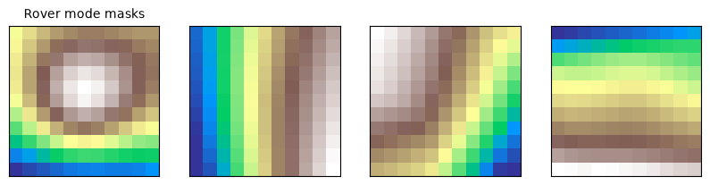
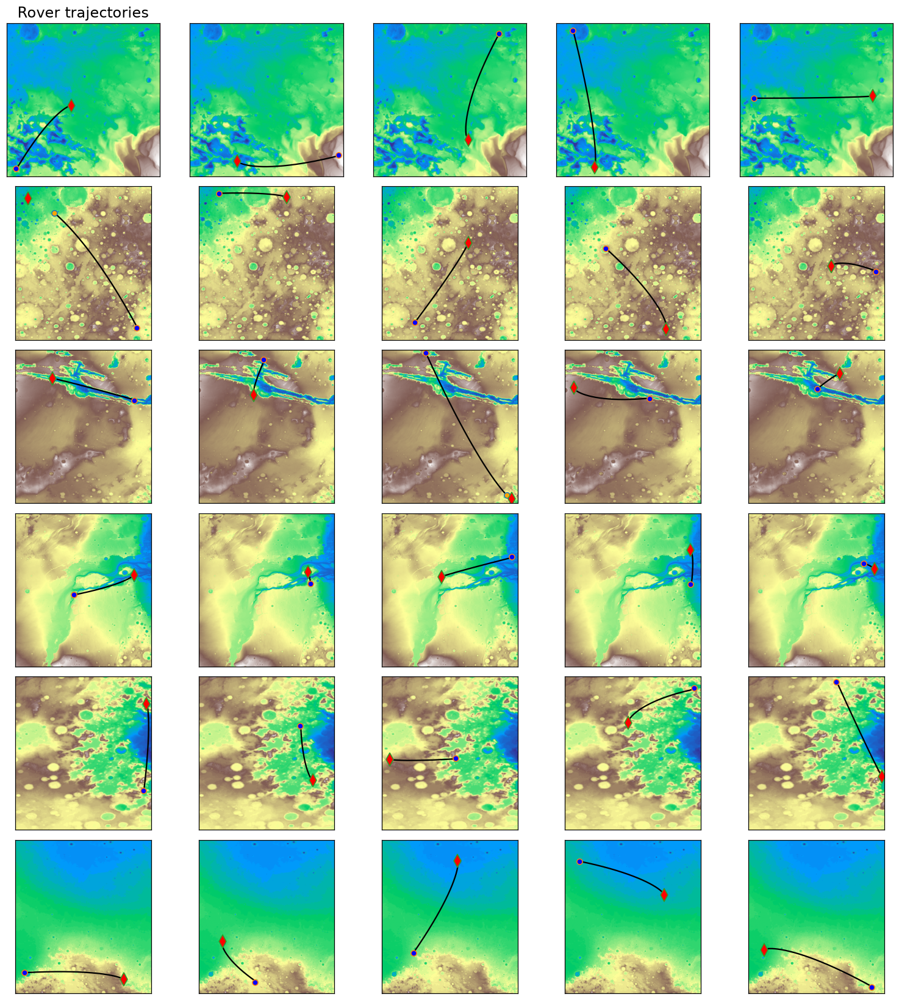

# ESA morphing rovers optimisation challenge

This code is a solution to the Optimisation challenge SPOC2 of the European Space Agency (https://optimise.esa.int/challenge/spoc-2-morphing-rovers/About).

Part of the solution that finished 2nd overall (team ML Actonauts).

The pipeline of this repository now reaches a fitness of **1.6783** over the 30 scenarios, against 2.0211 for the
submitted solution (lower is better).

## Set-up

Dependencies are managed with [uv](https://docs.astral.sh/uv/) (Python 3.10 or above):

```bash
uv sync
```

## Usage

The whole optimisation runs with a single command, configured by one file holding the parameters of every step
([`configs/default.yml`](configs/default.yml)):

```bash
uv run morphing-rovers run -c configs/default.yml
# any value can be overridden from the command line
uv run morphing-rovers run -c configs/default.yml -s output_dir=runs/test -s imitation.n_runs=1
```

1. **Masks** of the 4 rover modes. The terrain patches a rover drives over when heading straight for its sample
   are encoded by a convolutional autoencoder (a pretrained one is in `artifacts/autoencoder.pt`) and clustered.
   One mask is fitted per cluster by gradient ascent on the velocity function, then the masks are refined by
   reassigning each patch to its fastest mask and refitting them. Set `masks.from_chromosome` to reuse the masks
   of an existing chromosome instead. They are then refined on the routes of the rover, by alternating the fastest
   switching schedule and the time spent in each mode (the mean of 1 / velocity, each scenario counting the same).
2. **Heading offsets**. Heading straight for the sample is not the fastest way there: a rover keeping a constant
   angle from the sample spirals into it, over a different terrain. The best angle of each scenario is searched
   on the fastest switching schedule of each candidate, by alternating with the refinement of the masks (`offsets`
   section). Candidates leaving the map are scored like the simulator scores them, which rules them out.
3. **Steering**. Heading for the sample is a linear function of an input of the network, so by default it is wired
   into the network, on a hidden channel kept apart from training (`steering: wired`). The offsets are wired too:
   the first view tells the scenario apart, and a code solved in closed form from it is latched in the recurrent
   channel. With `steering: learned`, the network imitates the experts instead: the rover drives with its current
   network while an expert gives the steering it should have taken, heading for the sample or following an arc for
   the scenarios listed in `imitation.radius_factors`, on an increasing number of simulation steps per scenario.
   Arcs need learned steering, as following them is not a function a wired network can compute.
4. **Switching**. A rover can only morph into the best mode for the terrain under it, and doing so locks that mode
   for 9 steps, which may not be worth it depending on the terrain ahead. Dynamic programming over each route gives
   the fastest schedule, and the switch output of the network imitates it, DAgger-style: it is fitted to the
   decisions met in its own rollouts, each weighted by the steps at stake.

The run writes `config.yml`, `heading_offsets.json`, `masks.npy`, `switching.csv` (and `history.csv` with
`steering: learned`), `best_chromosome.npy` and `submission.json` to `output_dir`.

With [just](https://just.systems), `just solve` runs the same optimisation and copies the result to `solution.json`
at the root of the repository (extra arguments go to the command line, e.g. `just solve -s imitation.n_runs=1`).
`just export` writes `solution.json` from the best chromosome saved so far, which also works on an interrupted run.

Other commands:

```bash
uv run morphing-rovers evaluate artifacts/chromosomes/chromosome_2.0211.npy [--scenarios 0 5] [--plot]
uv run morphing-rovers submit runs/default/best_chromosome.npy -o submission.json --name my-submission
# fitness of single scenarios on each arc of the config's `sweep` section, driven by the fastest switching
# schedule, to choose `imitation.radius_factors`
uv run morphing-rovers sweep -c configs/default.yml -s sweep.scenarios=null
```

`artifacts/chromosomes` holds three trained chromosomes: `chromosome_2.0211.npy` (the submitted one),
`chromosome_2.0469.npy` and `chromosome_1.6783.npy`, the best of three seeds of the default config with 32 rounds of
switching (1.6783, 1.6818, 1.6886), which all reach 28 of the 30 samples.

## Code layout

| Module | Content |
| --- | --- |
| `udp.py` | Challenge simulation and fitness, identical to the official evaluation code |
| `chromosome.py` | Split, assemble, save and load chromosomes, wired steering and heading offsets |
| `masks.py`, `autoencoder.py` | Mode views along the straight paths, autoencoder, clustering, mask fitting |
| `routes.py` | Routes driven by the rover, fast simulation along them, fastest switching schedule and offset search |
| `experts.py`, `imitation.py` | Expert steering (straight line, arc, heading offset) and imitation learning of both network outputs |
| `pipeline.py`, `config.py`, `cli.py` | End-to-end optimisation, its configuration and the command line |
| `submission.py` | Submission file for the ESA optimise platform |

## Tests

```bash
uv run pytest                 # ~1.5 min
uv run pytest -m "not slow"   # skips the full 30-scenario evaluations
```

## Rovers' optimized masks (fitness 1.6783):



## Trajectories for the 30 scenarios (fitness 1.6783):


