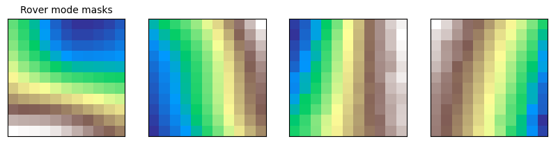
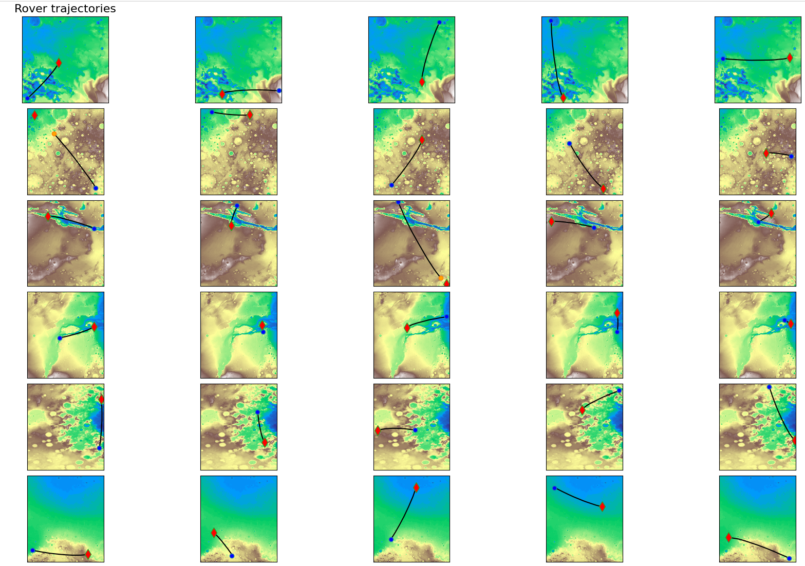

# ESA morphing rovers optimisation challenge

This code is a solution to the Optimisation challenge SPOC2 of the European Space Agency (https://optimise.esa.int/challenge/spoc-2-morphing-rovers/About).

Part of the solution that finished 2nd overall (team ML Actonauts).

## Set-up

Dependencies are managed with [uv](https://docs.astral.sh/uv/) (Python 3.10 or above):

```bash
uv sync
```

## Usage

The whole optimisation runs with a single command, configured by one file holding the parameters of every step
([`configs/default.yml`](configs/default.yml)):

```bash
uv run morphing-rovers run -c configs/default.yml
# any value can be overridden from the command line
uv run morphing-rovers run -c configs/default.yml -s output_dir=runs/test -s imitation.n_runs=1
```

1. **Masks** of the 4 rover modes. The terrain patches a rover drives over when heading straight for its sample
   are encoded by a convolutional autoencoder (a pretrained one is in `artifacts/autoencoder.pt`) and clustered.
   One mask is fitted per cluster by gradient ascent on the velocity function, then the masks are refined by
   reassigning each patch to its fastest mask and refitting them. Set `masks.from_chromosome` to reuse the masks
   of an existing chromosome instead.
2. **Controller**, by imitation learning. The rover drives with its current network while an expert gives the
   steering it should have taken, heading straight for the sample, or following an arc for the scenarios listed in
   `imitation.radius_factors`. The network is fitted to these targets on an increasing number of simulation steps
   per scenario. The rover always morphs into the fastest mode for the terrain it stands on.

The run writes `config.yml`, `masks.npy`, `history.csv`, `best_chromosome.npy` and `submission.json` to
`output_dir`.

Other commands:

```bash
uv run morphing-rovers evaluate artifacts/chromosomes/chromosome_2.0211.npy [--scenarios 0 5] [--plot]
uv run morphing-rovers submit runs/default/best_chromosome.npy -o submission.json --name my-submission
# imitation learning on single scenarios for each arc radius factor of the config's `sweep` section,
# to choose `imitation.radius_factors` (settings of the previous single-scenario experiments)
uv run morphing-rovers sweep -c configs/default.yml -s imitation.n_runs=50 -s imitation.buffer_size=5000
```

`artifacts/chromosomes` holds two trained chromosomes: `chromosome_2.0211.npy` (the submitted one) and
`chromosome_2.0469.npy`.

## Code layout

| Module | Content |
| --- | --- |
| `udp.py` | Challenge simulation and fitness, identical to the official evaluation code |
| `chromosome.py` | Split, assemble, save and load chromosomes |
| `masks.py`, `autoencoder.py` | Mode views along the straight paths, autoencoder, clustering, mask fitting |
| `experts.py`, `imitation.py` | Expert steering (straight line or arc) and imitation learning of the controller |
| `pipeline.py`, `config.py`, `cli.py` | End-to-end optimisation, its configuration and the command line |
| `submission.py` | Submission file for the ESA optimise platform |

## Tests

```bash
uv run pytest                 # ~1.5 min
uv run pytest -m "not slow"   # skips the full 30-scenario evaluations
```

## Example of Rovers' optimized masks:



## Example of tajectories for the 30 scenarios:


